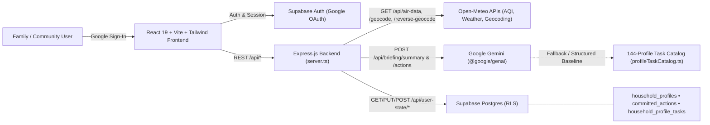
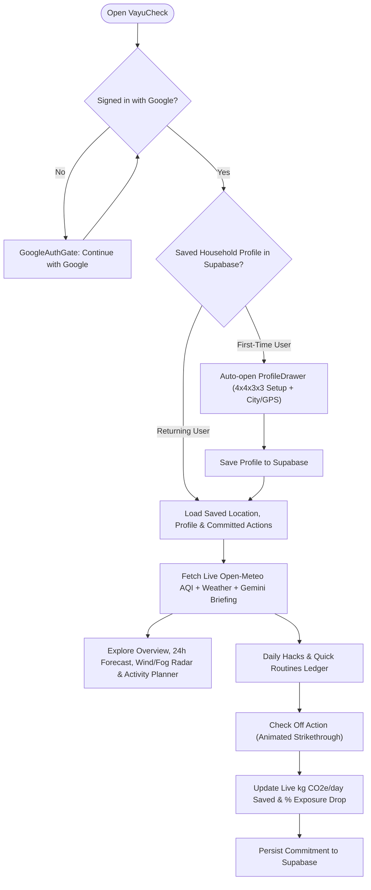

# VayuCheck — GenAI Urban Air & Winter Smog Assistant

> **Problem Statement:** Create a GenAI-powered assistant that helps families and communities navigate severe winter smog and urban air pollution. The application should suggest low-emission daily routines, indoor air quality hacks, and sustainable alternatives tailored to their location and lifestyle, while clearly explaining the direct impact of their choices.

**VayuCheck** combines live atmospheric and particulate telemetry (**Open-Meteo**), structured **Google Gemini** reasoning, and a **144-combination Household Profile matrix** persisted in **Supabase** to turn raw air-quality data into clear, personalized daily actions with quantified health and emission impacts.

---

## 1. How VayuCheck Solves the Problem

* **Hyper-Local Atmospheric Intelligence:** Fetches live **US AQI**, **PM2.5**, **PM10**, **NO₂**, **O₃**, **CO**, **SO₂**, wind speed/direction, temperature, and 24-hour dispersion forecasts via Open-Meteo, benchmarked against **WHO 2021 Air Quality Guidelines**.
* **Lifestyle-Tailored Personalization (144 Profile Combinations):** Every household configures 4 dimensions in the **Household Profile**:
  * **Sensitivity** (`4`): `general`, `children_elderly`, `asthma_respiratory`, `outdoor_worker`
  * **Commute** (`4`): `car`, `public_transit`, `walk_cycle`, `wfh`
  * **Heating & Cooking** (`3`): `gas`, `electric`, `solid_fuel`
  * **Indoor Setup** (`3`): `hepa_purifier`, `ac_filters`, `natural_ventilation`
* **Three-Category Actionable Daily Hacks:**
  1. **Low-Emission Daily Routines (`routine`)** — Timing errands around midday dispersion windows, cabin-air recirculation, and cleaner cooking habits.
  2. **Indoor Air Quality Hacks (`indoor_hack`)** — HEPA cycling, timed cross-ventilation windows, and dust/soot containment.
  3. **Sustainable Alternatives (`sustainable_alternative`)** — Transit/carpool swaps, induction/kettle shifts, and zero-combustion habits.
* **Direct Impact Transparency:** Every recommendation explicitly explains:
  * **Direct Health Impact** & **Scientific Mechanism** (why the choice reduces particulate/NO₂ inhalation).
  * **Direct Emission Impact** with quantified **kg CO₂e/day saved** and **% exposure drop** (aggregated live as users check off daily actions).
* **Safe Activity & Ventilation Windows:** Identifies the cleanest hours of the day for outdoor exercise, school commutes, and brief cross-ventilation.

---

## 2. System Architecture Flowchart



---

## 3. User Journey & Personalization Flow



---

## 4. Website Requirements

### Software & Runtime Prerequisites
* **Node.js** (v18+ or v22+ LTS recommended) and **npm**
* **Google Gemini API Key** (for server-side AI briefings in `server/geminiBriefing.ts`)
* **Supabase Project** with:
  * **Google OAuth** provider enabled in Supabase Authentication
  * Postgres tables: `household_profiles`, `committed_actions`, and `household_profile_tasks` (with Row-Level Security enabled)
* **Open-Meteo API** access (used server-side in `server/openMeteo.ts`; no API key required)

### Core Tech Stack
| Layer | Technologies |
|---|---|
| **Frontend** | React 19, TypeScript, Vite 8, Tailwind CSS v4, Lucide React, Motion |
| **Backend** | Node.js, Express 4, `tsx` |
| **AI & Data** | `@google/genai` (Gemini), Open-Meteo Air Quality & Weather APIs |
| **Auth & Database** | `@supabase/supabase-js` (Google OAuth + Postgres with RLS) |

### Environment Variables
Create a `.env` file in the project root (see `.env.example` — **never** commit `.env` to Git):

| Variable | Visibility | Purpose |
|---|---|---|
| `GEMINI_API_KEY` | **Server-only secret** | Used exclusively in `server/geminiBriefing.ts` (never exposed to browser) |
| `SUPABASE_URL` | Server config | Backend Supabase client (`server/supabase.ts`) |
| `SUPABASE_PUBLISHABLE_KEY` | Server config | Backend Supabase client (`server/supabase.ts`) |
| `VITE_SUPABASE_URL` | Client bundle | Frontend Supabase Auth client (`src/lib/supabase.ts`) |
| `VITE_SUPABASE_PUBLISHABLE_KEY` | Client bundle | Frontend Supabase Auth client (`src/lib/supabase.ts`) |
| `APP_URL` / `PORT` | Optional | Defaults to `PORT=3000` (`server.ts` binds to `0.0.0.0`) |

---

## 5. Project Structure

```text
VayuCheck/
├── server.ts                       # Express server, API routes & Vite/static serving
├── server/
│   ├── geminiBriefing.ts           # GenAI summary, action generation & fallback logic
│   ├── openMeteo.ts                # Live AQI, weather, geocoding & ventilation windows
│   ├── profileTaskCatalog.ts       # 144 household profile combinations catalog
│   └── supabase.ts                 # Server-side Supabase client & state persistence
├── src/
│   ├── App.tsx                     # Main dashboard orchestration & auth gate
│   ├── components/
│   │   ├── GoogleAuthGate.tsx      # Compulsory Google Sign-In screen
│   │   ├── TopBar.tsx              # Navigation & Household Profile trigger
│   │   ├── LocationToolbar.tsx     # City search, GPS detection & quick presets
│   │   ├── AirOverviewHero.tsx     # Live AQI, pollutants & AI briefing summary
│   │   ├── ForecastChart.tsx       # 24-hour AQI & particulate trend chart
│   │   ├── WindFogRadarMap.tsx     # Interactive wind, visibility & fog radar view
│   │   ├── ActivityPlanner.tsx     # Safe outdoor & ventilation time windows
│   │   ├── DailyBriefingLedger.tsx # Interactive Daily Hacks checklist & impact totals
│   │   └── ProfileDrawer.tsx       # 4-dimension Household Profile & onboarding drawer
│   ├── lib/
│   │   ├── airStyle.ts             # AQI severity bands & display labels
│   │   └── supabase.ts             # Browser Supabase client
│   └── types/air.ts                # Shared TypeScript interfaces
├── .env.example                    # Environment variable template
├── package.json                    # Scripts and dependencies
└── vite.config.ts                  # Vite build & asset configuration
```

---

## 6. Run Locally & Deploy

### Local Development
1. **Install dependencies:**
   ```bash
   npm install --legacy-peer-deps
   ```
2. **Configure environment:** Copy `.env.example` to `.env` and fill in your `GEMINI_API_KEY` and Supabase credentials.
3. **Start the development server:**
   ```bash
   npm run dev
   ```
4. Open **`http://localhost:3000`** in your browser.

### Production Build & Render Deployment
* **Build Command:**
  ```bash
  npm install --include=dev --legacy-peer-deps && npm run build
  ```
* **Start Command:**
  ```bash
  npx tsx server.ts
  ```
* **Health Check Path:** `/api/health`
* Set `NODE_ENV=production` and all environment variables in your host's secrets/environment panel so `GEMINI_API_KEY` stays strictly on the server.
