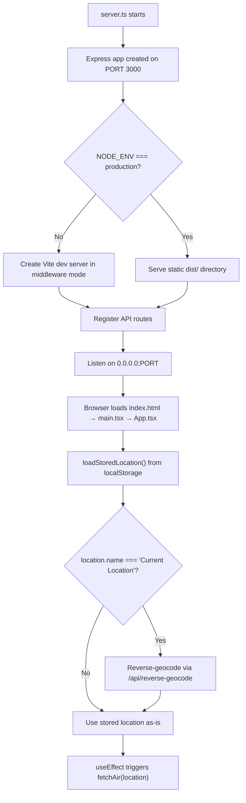
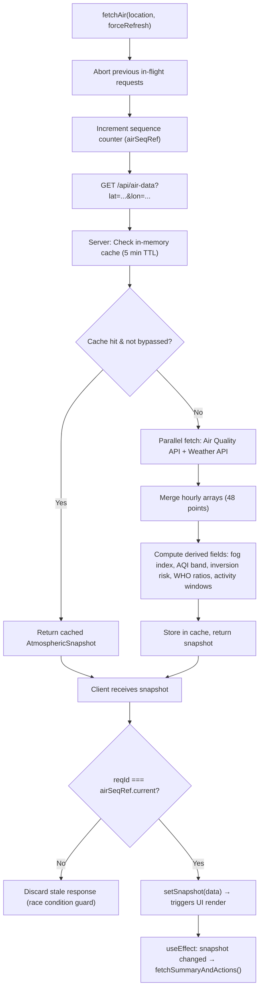
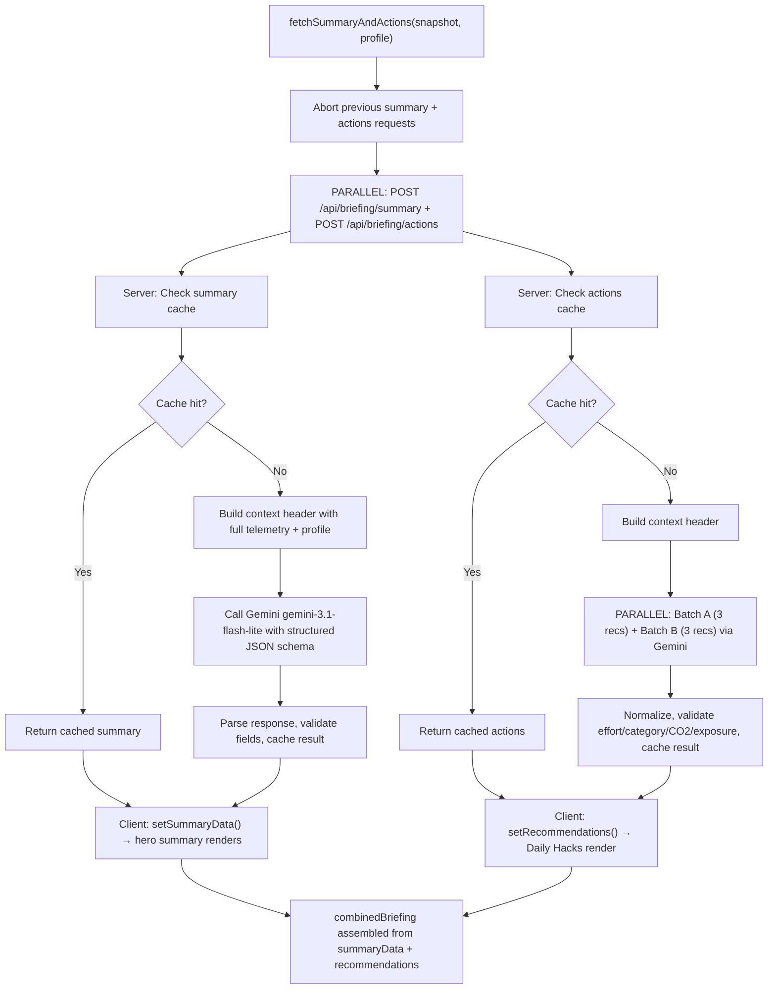
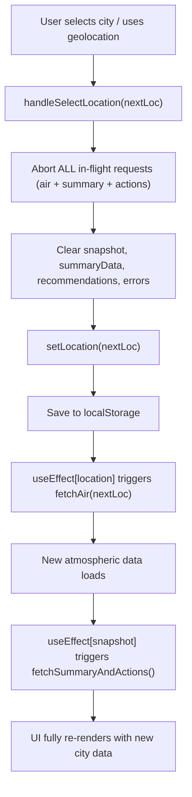
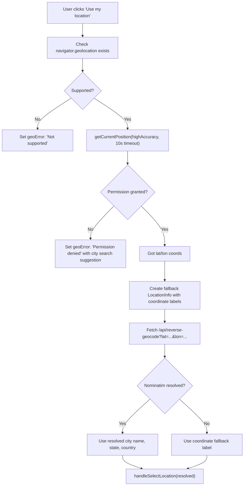

# Air Almanac — Complete Project Execution Report

> **Document generated:** 2026-11-21  
> **Project root:** `C:\Users\barun\antigravity\Air-Almanac`  
> **Runtime URL:** `http://localhost:3000`

---

## Table of Contents

1. [Project Overview](#1-project-overview)
2. [Complete Feature Inventory](#2-complete-feature-inventory)
3. [All Input Options & Data Sources](#3-all-input-options--data-sources)
4. [All APIs & Integrations](#4-all-apis--integrations)
5. [Complete Tech Stack](#5-complete-tech-stack)
6. [Operations Flow & Conditional Logic](#6-operations-flow--conditional-logic)
7. [File Architecture](#7-file-architecture)
8. [Design System & Visual Tokens](#8-design-system--visual-tokens)
9. [Data Types & Interfaces](#9-data-types--interfaces)
10. [Caching & Performance Strategy](#10-caching--performance-strategy)
11. [Error Handling & Edge Cases](#11-error-handling--edge-cases)
12. [Accessibility & Responsive Design](#12-accessibility--responsive-design)

---

## 1. Project Overview

**Air Almanac** is a GenAI-powered, real-time urban air quality and winter smog dashboard. It combines live Open-Meteo atmospheric forecasting data with structured Gemini AI-generated daily routines, indoor air hacks, and safe activity planning to help families and communities navigate severe urban air pollution.

### Core Mission
Help households in heavily polluted urban corridors (Delhi, Kolkata, Lahore, Beijing, Milan, London, Los Angeles) make informed daily decisions about commuting, ventilation, exercise timing, and indoor air management based on live scientific telemetry.

### Design Philosophy
- **Nordic Civic Instrument Aesthetic** — zero AI-cliché gradients, candy pills, or pulsing decorative dots.
- **WHO 2021 Air Quality Guidelines** as the benchmark reference for all pollutant thresholds.
- **Tabular figures** (`font-variant-numeric: tabular-nums`) for every numeric readout.
- **Gemini API key kept strictly server-side** — never exposed in frontend bundles.

---

## 2. Complete Feature Inventory

### 2.1 Real-Time Atmospheric Overview (`AirOverviewHero.tsx`)

| Sub-Feature | Detail |
|---|---|
| **Live AQI Display** | US AQI (0–500) as a large monospaced numeral with EU AQI cross-reference and PM2.5-to-WHO-limit multiplier (e.g., `1.4× WHO limit`). |
| **AQI Band Classification** | 6-tier system: Good (≤50), Moderate (≤100), Sensitive (≤150), Unhealthy (≤200), Very Unhealthy (≤300), Hazardous (>300). Each has a unique glyph (●, ◆, ▲, ■), color tone, surface tint, and border tint. |
| **Smart Alert Banner** | Conditionally rendered when `usAqi ≥ 101` OR `inversion.risk === 'high'` OR `briefing.alert.active === true`. Shows severity label, primary pollutant driver, inversion status, headline text, up to 3 immediate action items, and best ventilation window. |
| **Today's Briefing Summary** | AI-generated 2-sentence summary referencing the city's exact AQI, PM2.5, and household priority. Shows skeleton loader during generation. |
| **6-Pollutant WHO Comparison Table** | PM2.5, PM10, NO₂, O₃, SO₂, CO — each showing current value (µg/m³), WHO 2021 24h/8h limit, ratio-to-WHO, and status (Within WHO / Above WHO / High / Severe) with color-coded status text. |
| **Boundary-Layer Dispersion Analysis** | Inversion risk assessment (Low / Moderate / High) with explanation of wind speed, humidity, PM2.5, and temperature range impacts on pollutant trapping. |
| **4-Column Meteorological Strip** | Temperature (°C), Wind Dispersion (km/h), Relative Humidity (%), and Visibility (km). |
| **Animated Weatherman Character** | Live GIF (`weatherman.gif`) with dynamic SVG wind streams, rain streaks, fog overlay, and physics-based wind sway/skew transformations. |
| **Wind & Fog Radar Map** | Full-width horizontal radar scope with concentric distance rings (5–20 km), animated wind flow particles, compass headings (N/E/S/W), central station beacon, dominant direction arrow vector, rotating radar sweep, fog density radial cloud, and 3-panel telemetry dashboard (Wind Vector, Optical Range, Dispersion Layer). |

### 2.2 48-Hour Forecast Chart (`ForecastChart.tsx`)

| Sub-Feature | Detail |
|---|---|
| **Custom SVG Line Chart** | 960×270 viewBox, responsive, pointer-interactive crosshair inspection, keyboard arrow-key navigation. |
| **4 Tabbed Views** | `AQI & PM2.5` (with WHO 15 µg/m³ reference dashed line), `Dust & Gases` (PM10, NO₂, O₃), `Wind & Humidity` (wind speed km/h, relative humidity %), `Rain & Fog` (rain precipitation mm, fog/mist index 0–100%). |
| **Crosshair Inspection Bar** | Snapped to nearest hourly point; displays day (Today/Tomorrow), hour label, US AQI, PM2.5, PM10, NO₂, Wind, Temp/RH, Rain/Fog with inline series legend. |
| **Day Separator** | Dashed vertical line marking the Today→Tomorrow boundary. |
| **X-Axis Ticks** | Every 6 hours for 48 total hours. |

### 2.3 Safe Activity Window Planner (`ActivityPlanner.tsx`)

| Sub-Feature | Detail |
|---|---|
| **5 Activity Templates** | School & Work Commute (06:00–10:00), Outdoor Walk & Exercise (06:00–20:00), Home Cross-Ventilation (10:00–17:00), Children Outdoor Play (09:00–18:00), Evening Errands & Transit (16:00–21:00). |
| **Today/Tomorrow Tabs** | Each activity scanned independently for both day 0 and day 1 from the 48-hour hourly forecast. |
| **Best 2-Hour Slot Algorithm** | Sliding 2-hour window over the hourly AQI forecast; selects the window with the lowest average US AQI. |
| **4-Tier Activity Rating** | Recommended (AQI ≤60), Caution (≤110), Limit & Mask (≤165), Avoid Outdoors (>165). Each has glyph, color, and protection guidance. |
| **Cross-Ventilation Override** | Specialized protection notes for ventilation: "Open opposite windows for 15–20 min" (AQI ≤80), "Limit to 10 min, then filter" (≤140), "Keep sealed" (>140). |
| **AI-Tailored Activity Tips** | Gemini generates a per-activity `tailoredTip` sentence for Today's activities only, displayed alongside the standard protection note. |

### 2.4 Daily Hacks & Quick Routines (`DailyBriefingLedger.tsx`)

| Sub-Feature | Detail |
|---|---|
| **Sliding Category Filter Tabs** | All Hacks, Low-Emission Routines, Indoor Air Hacks, Sustainable Swaps — with rounded pill UI, shadow-on-active, hover glow. |
| **6 AI-Generated Recommendation Cards** | Generated in 2 parallel Gemini batches of 3 each. Each card has: `id`, `category`, `title`, `effort` (Low/Medium/Habit shift), `timeframe`, 2–3 practical `steps`, `directHealthImpact`, `directEmissionImpact`, `scientificMechanism`, `estimatedCo2KgSaved` (0.2–8.0 kg), `estimatedExposureDropPct` (5–45%). |
| **Interactive Toggle Switch** | Sliding toggle (`role="switch"`, `aria-checked`) with smooth color transition (grey→Civic Pine), inner circle with checkmark icon, and "To do" / "Done" label beneath. |
| **Animated Strikethrough Cut-Line** | On completion, an animated 2px horizontal line (`bg-[#1F4E43]`) expands from `w-0` to `w-full` across the title with 350ms ease-out transition. Card border shifts to green-tinted, background to soft green. |
| **Expandable Steps & Rationale** | Each card has a "Steps & rationale" / "Hide steps" toggle that reveals numbered practical steps and a "Why This Choice Matters" scientific mechanism paragraph. |
| **Cumulative Impact Ledger** | 3-column strip: "Daily Hacks Completed" (X / 6), "Direct Household Emissions Avoided" (kg CO₂e), "Estimated Indoor PM2.5 Exposure Drop" (%). Exposure drop uses diminishing-returns multiplication (capped at 68%). |
| **Profile Context Display** | Shows current profile calibration: sensitivity group, commute mode, heating/cooking fuel, indoor setup, household size. |

### 2.5 Household Profile Calibration (`ProfileDrawer.tsx`)

| Sub-Feature | Detail |
|---|---|
| **Slide-In Drawer** | Fixed-position right-side drawer with backdrop blur overlay, `aria-modal="true"`, Escape-key close. |
| **5 Configuration Axes** | Primary Health Sensitivity (4 options), Daily Commute Mode (4 options), Home Cooking & Heating Fuel (3 options), Indoor Air Filtration Setup (3 options), Household Members (1–12, ±1 stepper). |
| **Instant Re-Generation** | Saving triggers `fetchSummaryAndActions()` with updated profile, regenerating all Gemini content in parallel. |
| **localStorage Persistence** | Stored under `air_almanac_profile_v1`. Survives page reload. |

### 2.6 Location & Navigation System

| Sub-Feature | Detail |
|---|---|
| **City Search Autocomplete** | 260ms debounced; queries Open-Meteo Geocoding API (`/v1/search?name=...&count=7`); shows up to 7 results with name, admin1, country, and lat/lon coordinates. Enter key selects first result. |
| **7 Preset Smog Corridor Cities** | New Delhi, Kolkata, Lahore, Beijing, Milan, London, Los Angeles — shown when search box is focused but empty. |
| **Browser Geolocation** | `navigator.geolocation.getCurrentPosition()` with `enableHighAccuracy: true`, 10s timeout. Reverse-geocodes coordinates via Nominatim to resolve city name, state, country. |
| **Sticky Top Navigation Bar** | 4 anchor links (Overview, Forecast, Activity Planner, Daily Hacks) with smooth scroll, hover underline with Civic Pine decoration, and "Household Profile" CTA button. |
| **Observation Metadata Strip** | City name, admin1, country, coordinates (°N/°S, °E/°W), observation ISO time, and timezone. |

### 2.7 Animated Weather Illustration (`WeatherHeroIllustration.tsx`)

| Sub-Feature | Detail |
|---|---|
| **Animated GIF** | `weatherman.gif` (1.9 MB, 640×360, 30 frames) embedded with `mix-blend-multiply` for white-background elimination. |
| **Dynamic Wind Streams** | 4 SVG `<path>` elements with `strokeDasharray="16 10"` and CSS `dash` keyframe animation. Speed tied to `windSpeed / 35` intensity. |
| **Rain Streaks** | Up to 20 SVG `<line>` elements with `rainFall` keyframe when `rainMm > 0.05`. Count and speed scale with rain intensity (mm/h). |
| **Fog Overlay** | Radial-gradient haze layer with `backdrop-blur-[0.5px]` when `visibilityKm ≤ 3.5` or `humidity ≥ 85 && windSpeed < 10`. Opacity scales inversely with visibility. |
| **Physics-Based Sway** | Character image applies `skewX(windIntensity × -5°)` and `rotate(windIntensity × 1.5°)`. Spinning dashed whirlpool circle speed increases with wind. |
| **Live Status Badge** | Rounded pill showing `{windSpeed} km/h wind · {condition}` where condition is rain mm, Hazy/Foggy, Breezy, or Calm. |

### 2.8 Wind & Fog Radar Map (`WindFogRadarMap.tsx`)

| Sub-Feature | Detail |
|---|---|
| **SVG Circular Radar Scope** | 260×130 viewBox with 4 concentric range rings (28, 56, 84, 110 radius). Cardinal crosshairs and compass labels. |
| **Animated Radar Sweep** | CSS `conic-gradient` with `spin 6s linear infinite` rotation. |
| **Wind Flow Particles** | 9 animated `<line>` elements with `dash` keyframe flowing along the wind direction vector (`windDirection` degrees, converted to radians). |
| **Central Station Beacon** | Radial glow gradient + solid dot at origin with Civic Pine coloring. |
| **Direction Arrow Vector** | `<line>` from origin to `arrowDx * 1.3, arrowDy * 1.3` with gradient stroke and endpoint circle. |
| **Fog Density Cloud** | Radial gradient overlay with blur(10px), opacity scaled to `fogIndex / 100`. |
| **3-Panel Telemetry Dashboard** | Wind Vector (speed, direction, stagnant/active status), Optical Range (visibility km, fog index %, humidity), Dispersion Layer (inversion trapping vs. ventilated flow narrative). |
| **Fog Severity Badge** | Dense Fog Trapping (red, fogIndex ≥65 or vis <2.5 km), Hazy Mist/Inversion (amber), Clear Atmosphere (green). |

---

## 3. All Input Options & Data Sources

### 3.1 User Inputs

| Input | Source | Stored In | Detail |
|---|---|---|---|
| **City Search Query** | Text input, min 2 characters | Not persisted | Triggers debounced Open-Meteo Geocoding API call |
| **Preset City Selection** | 7 hardcoded cities from `PRESET_CITIES` array | `localStorage` → `air_almanac_location_v1` | New Delhi (default), Kolkata, Lahore, Beijing, Milan, London, Los Angeles |
| **Browser Geolocation** | `navigator.geolocation` with high accuracy | `localStorage` → `air_almanac_location_v1` | Coordinates reverse-geocoded via Nominatim |
| **Health Sensitivity** | Radio-button fieldset | `localStorage` → `air_almanac_profile_v1` | `general`, `children`, `seniors`, `respiratory` |
| **Commute Mode** | 2×2 grid buttons | `localStorage` → `air_almanac_profile_v1` | `car`, `two_wheeler`, `transit`, `walk_cycle` |
| **Heating/Cooking Fuel** | Stacked buttons | `localStorage` → `air_almanac_profile_v1` | `gas`, `electric`, `solid_fuel` |
| **Indoor Filtration** | Stacked buttons | `localStorage` → `air_almanac_profile_v1` | `hepa_purifier`, `ac_filter`, `natural_ventilation` |
| **Household Size** | ±1 stepper (1–12 range) | `localStorage` → `air_almanac_profile_v1` | Integer, default 4 |
| **Completed Hack Toggles** | Slide toggle switches | `localStorage` → `air_almanac_commits_v1` | Array of recommendation IDs, reset daily via `getTodayKey()` |
| **Forecast Chart Tab** | 4-way tab selector | React state only | `aqi_pm25`, `gases`, `dispersion`, `rain_fog` |
| **Activity Planner Day** | 2-way Today/Tomorrow tabs | React state only | `0` (today) or `1` (tomorrow) |
| **Category Filter** | 4-way sliding tab | React state only | `all`, `routine`, `indoor_hack`, `sustainable_alternative` |
| **Chart Crosshair Position** | Pointer/keyboard | React state only | Index into 48-element `hourly[]` array |
| **Manual Refresh** | Refresh button | N/A | Triggers `fetchAir(location, true)` bypassing cache |

### 3.2 Data Fed Into the System

| Data Point | Source | Frequency | Detail |
|---|---|---|---|
| **US AQI (current + 48h hourly)** | Open-Meteo Air Quality API | Per location fetch (5 min cache) | `us_aqi` field |
| **EU AQI** | Open-Meteo Air Quality API | Same | `european_aqi` field |
| **PM2.5** | Open-Meteo Air Quality API | Same | `pm2_5` in µg/m³ |
| **PM10** | Open-Meteo Air Quality API | Same | `pm10` in µg/m³ |
| **NO₂** | Open-Meteo Air Quality API | Same | `nitrogen_dioxide` in µg/m³ |
| **O₃** | Open-Meteo Air Quality API | Same | `ozone` in µg/m³ |
| **SO₂** | Open-Meteo Air Quality API | Same | `sulphur_dioxide` in µg/m³ |
| **CO** | Open-Meteo Air Quality API | Same | `carbon_monoxide` in µg/m³ |
| **Temperature** | Open-Meteo Weather Forecast API | Same | `temperature_2m` in °C |
| **Relative Humidity** | Open-Meteo Weather Forecast API | Same | `relative_humidity_2m` in % |
| **Wind Speed** | Open-Meteo Weather Forecast API | Same | `wind_speed_10m` in km/h |
| **Wind Direction** | Open-Meteo Weather Forecast API | Same | `wind_direction_10m` in degrees (0–360) |
| **Surface Pressure** | Open-Meteo Weather Forecast API | Same | `surface_pressure` in hPa |
| **Visibility** | Open-Meteo Weather Forecast API | Same | `visibility` in meters → converted to km |
| **Rain/Precipitation** | Open-Meteo Weather Forecast API | Same | `rain` or `precipitation` in mm/h |
| **Fog Index** | Computed server-side | Derived | 0–100 score from visibility and humidity: vis ≤1km → 80–100, vis ≤3.5km → 40–80 (humidity-weighted), vis ≤6km & RH ≥85% → 0–35 |
| **Timezone** | Open-Meteo API response | Same | Auto-detected from coordinates (e.g., `Asia/Kolkata`) |

---

## 4. All APIs & Integrations

### 4.1 Open-Meteo Air Quality API (No API Key Required)

| Endpoint | Method | Parameters | Response Data |
|---|---|---|---|
| `https://air-quality-api.open-meteo.com/v1/air-quality` | GET | `latitude`, `longitude`, `current=us_aqi,european_aqi,pm2_5,pm10,nitrogen_dioxide,ozone,sulphur_dioxide,carbon_monoxide`, `hourly=` (same fields), `timezone=auto`, `forecast_days=2` | Current + 48-hour hourly arrays for all air quality parameters |

### 4.2 Open-Meteo Weather Forecast API (No API Key Required)

| Endpoint | Method | Parameters | Response Data |
|---|---|---|---|
| `https://api.open-meteo.com/v1/forecast` | GET | `latitude`, `longitude`, `current=temperature_2m,relative_humidity_2m,wind_speed_10m,wind_direction_10m,surface_pressure,rain,precipitation`, `hourly=` (same + `visibility`), `timezone=auto`, `forecast_days=2` | Current + 48-hour hourly arrays for all weather parameters |

### 4.3 Open-Meteo Geocoding API (No API Key Required)

| Endpoint | Method | Parameters | Response Data |
|---|---|---|---|
| `https://geocoding-api.open-meteo.com/v1/search` | GET | `name={query}`, `count=7`, `language=en`, `format=json` | Array of `{name, admin1, country, latitude, longitude, timezone}` |

### 4.4 Nominatim Reverse Geocoding (No API Key Required)

| Endpoint | Method | Parameters | Response Data |
|---|---|---|---|
| `https://nominatim.openstreetmap.org/reverse` | GET | `lat`, `lon`, `format=jsonv2`, `zoom=10` | `{name, address: {city, town, village, municipality, suburb, state_district, county, state, country}}` |
| **Headers** | — | `User-Agent: AirAlmanac/1.0 (civic-air-dashboard)`, `Accept-Language: en` | — |
| **Timeout** | — | 4500 ms AbortController | Falls back to `Current Location` label with coordinate display |

### 4.5 Google Gemini API (Requires `GEMINI_API_KEY` Server-Side)

| Endpoint | Method | Model | Config | Purpose |
|---|---|---|---|---|
| `/api/briefing/summary` | POST | `gemini-3.1-flash-lite` | `ThinkingLevel.MINIMAL`, `responseMimeType: 'application/json'`, structured JSON schema | Generates `headlineSummary` (2 sentences), `inversionExplanation`, `alert` object (active/severity/headline/3 actions), `activityNotes` (5 per-activity tips) |
| `/api/briefing/actions` | POST | `gemini-3.1-flash-lite` | Same config, 2 parallel batch calls | Generates 6 recommendations across 3 categories (2 routine, 2 indoor_hack, 2 sustainable_alternative) with quantified impacts |
| `/api/briefing` | POST | Calls both above | Parallel `Promise.all()` | Returns combined `DailyBriefing` object |

#### Gemini Prompt Engineering Details

- **System instruction:** `"You are a concise environmental health and urban meteorology advisor. Ground every sentence strictly in the provided city telemetry. Plain English only."`
- **Context header** fed to every prompt includes: exact city name with admin1/country, current AQI/band/PM2.5/WHO multiple, all pollutant values, weather conditions (temp/humidity/wind/visibility/inversion), ventilation window, all activity windows with ratings, full household profile (sensitivity/commute/heating/indoor/size).
- **Response schema** enforced via `Type.OBJECT` with `required` fields — Gemini returns structured JSON, not free text.
- **Retry logic:** 1 automatic retry with 350ms×(attempt+1) backoff for transient errors; non-retryable errors (API_KEY_INVALID, PERMISSION_DENIED, 400, 403, 404) fail immediately.
- **Recommendation batches:** 2 parallel batches of 3 recommendations each — batch A covers commute timing, cooking emissions, indoor hack; batch B covers draft-sealing, transport alternative, sustainable appliance.

### 4.6 Internal Express REST API Endpoints

| Route | Method | Input | Output | Detail |
|---|---|---|---|---|
| `/api/health` | GET | — | `{status: "ok"}` | Health check |
| `/api/geocode` | GET | `?q=cityName` | `{results: LocationInfo[]}` | Proxies Open-Meteo Geocoding |
| `/api/reverse-geocode` | GET | `?lat=...&lon=...` | `{location: LocationInfo}` | Proxies Nominatim reverse geocoding |
| `/api/air-data` | GET | `?lat=...&lon=...&name=...&country=...&admin1=...&refresh=1` | `AtmosphericSnapshot` | Fetches + processes Open-Meteo AQ + Weather, computes all derived fields |
| `/api/briefing/summary` | POST | `{snapshot, profile, forceRefresh}` | `BriefingSummaryPayload` | Gemini-generated summary + alert + activity notes |
| `/api/briefing/actions` | POST | `{snapshot, profile, forceRefresh}` | `BriefingActionsPayload` | Gemini-generated 6 recommendation cards |
| `/api/briefing` | POST | `{snapshot, profile, forceRefresh}` | `DailyBriefing` | Combined summary + actions |

---

## 5. Complete Tech Stack

### 5.1 Frontend

| Technology | Version | Purpose |
|---|---|---|
| **React** | 19.0.1 | UI framework with hooks (useState, useEffect, useCallback, useMemo, useRef) |
| **TypeScript** | 7.0.2 | Strict type safety, `ES2022` target, `react-jsx` JSX transform |
| **Vite** | 8.3.0 | Dev server (HMR), production bundler, SPA middleware mode |
| **Tailwind CSS** | 4.3.3 (v4) | Utility-first CSS with `@theme` custom design tokens, `@layer base` rules |
| **Lucide React** | 0.546.0 | Iconography (SlidersHorizontal, Search, X, LocateFixed, RefreshCw, Check, ChevronDown, ChevronUp, Minus, Plus, Compass, Eye, Wind, Radio, Activity) |
| **Motion** | 12.23.24 | Animation library (available, primary animations use CSS keyframes + inline styles) |
| **Google Fonts** | — | Plus Jakarta Sans (headings: 500/600/700), DM Sans (body: 400/500/600), IBM Plex Mono (data: 400/500/600) |

### 5.2 Backend

| Technology | Version | Purpose |
|---|---|---|
| **Node.js** | Runtime | Server execution |
| **Express** | 4.21.2 | HTTP server, JSON body parsing (1 MB limit), API routes, Vite middleware integration |
| **tsx** | 4.21.0 | TypeScript execution for `server.ts` without compilation step |
| **dotenv** | 17.2.3 | Loads `GEMINI_API_KEY` and `PORT` from `.env` file |
| **@google/genai** | 2.4.0 | Official Google GenAI SDK for Gemini API calls with `ThinkingLevel`, `Type` schema enforcement |

### 5.3 Build & Dev Tools

| Tool | Purpose |
|---|---|
| **@tailwindcss/vite** | Tailwind v4 Vite plugin for JIT compilation |
| **@vitejs/plugin-react** | React Fast Refresh, JSX transform |
| **esbuild** | 0.25.0 — underlying bundler for Vite |
| **autoprefixer** | CSS vendor prefixing |
| **Custom Vite Plugin** (`copy-unbundled-src-assets`) | Copies `src/assets/` into `dist/src/assets/` during production build so root-relative URLs resolve |

### 5.4 Environment & Configuration

| File | Purpose |
|---|---|
| `.env` | Contains `GEMINI_API_KEY` (server-side only) and optional `PORT` |
| `metadata.json` | App name, description, `requestFramePermissions: ["geolocation"]`, `majorCapabilities: ["MAJOR_CAPABILITY_SERVER_SIDE_GEMINI_API"]` |
| `tsconfig.json` | `ES2022` target, `ESNext` modules, `bundler` module resolution, `@/*` path alias |
| `vite.config.ts` | React + Tailwind plugins, `@` alias, conditional HMR disable via `DISABLE_HMR` env |

---

## 6. Operations Flow & Conditional Logic

### 6.1 Application Boot Sequence



### 6.2 Data Fetch & Render Pipeline



### 6.3 Gemini Briefing Generation Pipeline



### 6.4 Location Change Flow



### 6.5 Geolocation Flow with Reverse Geocoding



### 6.6 Conditional Rendering Rules

| Condition | Result |
|---|---|
| `airError !== null` | Shows red error card with "Open-Meteo data unavailable" and "Retry forecast fetch" button |
| `airLoading && !snapshot` | Shows skeleton loader (placeholder cards) with loading message |
| `snapshot !== null` | Renders full dashboard: AirOverviewHero → ForecastChart → ActivityPlanner → DailyBriefingLedger |
| `showAlert = usAqi ≥ 101 ∥ inversion.risk === 'high' ∥ briefing.alert.active` | Alert banner renders at top of overview |
| `summaryLoading && !briefing` | Briefing section shows skeleton text loaders |
| `actionsLoading && recommendations.length === 0` | Daily Hacks shows 4 skeleton card placeholders |
| `error (actions)` | Shows red error card with "Retry briefing" button |
| `filtered.length === 0` | "No hacks match this category" message |
| `isFoggy = visibilityKm ≤ 3.5 ∥ (humidity ≥ 85 && windSpeed < 10)` | Fog overlay layer renders on weatherman illustration |
| `isRaining = rainMm > 0.05` | Rain streaks SVG elements render |
| `isStagnant = windSpeed < 6` | Radar map shows "Inversion Trapping" in dispersion panel |
| `isDenseFog = fogIndex ≥ 65 ∥ visibilityKm < 2.5` | "Dense Fog Trapping" red badge on radar map |

### 6.7 AQI Classification Logic

| US AQI Range | Band | Label | Glyph | Color Tokens |
|---|---|---|---|---|
| 0–50 | `good` | Good | ● | `#2D6A4F` text, `#F2F7F4` surface, `#C8DFD3` border |
| 51–100 | `moderate` | Moderate | ◆ | `#9A6B16` text, `#FAF6EC` surface, `#E6D7B5` border |
| 101–150 | `sensitive` | Unhealthy for Sensitive Groups | ▲ | `#B84A27` text, `#FBF3EF` surface, `#E9CBC0` border |
| 151–200 | `unhealthy` | Unhealthy | ▲ | `#B84A27` text, `#FAF1ED` surface, `#E5BFB1` border |
| 201–300 | `very_unhealthy` | Very Unhealthy | ■ | `#7F1D1D` text, `#F9EFEF` surface, `#E2BDBD` border |
| 301+ | `hazardous` | Hazardous | ■ | `#7F1D1D` text, `#F9EFEF` surface, `#E2BDBD` border |

### 6.8 Inversion Risk Assessment Logic

```
IF windSpeed < 7 AND pm25 ≥ 35:  → HIGH inversion
   OR windSpeed < 5 AND humidity ≥ 70:  → HIGH inversion
ELSE IF windSpeed < 12 AND (pm25 ≥ 18 OR tempRange ≥ 10):  → MODERATE
ELSE:  → LOW (Active Dispersion)
```

### 6.9 Pollutant WHO Status Classification

| Ratio to WHO Limit | Status | Color |
|---|---|---|
| ≤ 1.0 | Within WHO | `#2D6A4F` (green) |
| 1.0 – 2.0 | Above WHO (Elevated) | `#9A6B16` (amber) |
| 2.0 – 4.0 | High | `#B84A27` (orange) |
| > 4.0 | Severe | `#7F1D1D` (dark red) |

### 6.10 Fog Index Derivation Formula

```
IF visibility ≤ 1.0 km:
    fogIndex = min(100, round(80 + (1.0 - visibility) × 20))
ELSE IF visibility ≤ 3.5 km:
    fogIndex = round(40 + ((3.5 - visibility) / 2.5) × 40 × (RH ≥ 75 ? 1.0 : 0.7))
ELSE IF visibility ≤ 6.0 km AND RH ≥ 85%:
    fogIndex = round(((6.0 - visibility) / 2.5) × 35)
ELSE:
    fogIndex = 0
```

### 6.11 Ventilation Window Advisability

```
bestVentilationWindow.advisable = (windowAvgAqi ≤ 135)
```

### 6.12 Cumulative Exposure Drop Calculation (Diminishing Returns)

```typescript
const remainingExposureFactor = committedRecs.reduce(
    (prod, r) => prod * (1 - r.estimatedExposureDropPct / 100),
    1.0
);
const combinedDrop = min(68%, round((1 - remainingExposureFactor) × 100));
```

### 6.13 Daily Commits Reset Logic

Committed hack IDs are stored with today's date key (`YYYY-MM-DD`). On load, if the stored date doesn't match today, the array is reset to empty — ensuring a fresh daily cycle.

---

## 7. File Architecture

```
Air-Almanac/
├── .env                              # GEMINI_API_KEY (server-only)
├── index.html                        # HTML shell: Google Fonts, SEO/OG tags, body bg
├── metadata.json                     # App name, geolocation permission, Gemini capability
├── package.json                      # Dependencies, scripts (dev/build/lint)
├── tsconfig.json                     # TypeScript config: ES2022, bundler resolution
├── vite.config.ts                    # Vite + React + Tailwind plugins, asset copy plugin
├── server.ts                         # Express server: API routes + Vite middleware
│
├── server/
│   ├── openMeteo.ts                  # Open-Meteo API client + data processing (681 lines)
│   └── geminiBriefing.ts             # Gemini AI briefing generation (410 lines)
│
├── src/
│   ├── main.tsx                      # React DOM entry: createRoot + <App />
│   ├── index.css                     # Tailwind v4 @theme tokens, @layer base, keyframes
│   ├── App.tsx                       # Root component: state, effects, data fetching (495 lines)
│   │
│   ├── types/
│   │   └── air.ts                    # All TypeScript interfaces & types (160 lines)
│   │
│   ├── lib/
│   │   └── airStyle.ts               # AQI tones, presets, profile display, formatters (208 lines)
│   │
│   ├── assets/
│   │   ├── weatherman.gif            # Animated weatherman character (1.9 MB)
│   │   ├── Gemini_Generated_Gif_9lrzwy9lrzwy9lrz.gif  # Source GIF (identical)
│   │   └── live_radar_map.png        # Reference screenshot
│   │
│   └── components/
│       ├── TopBar.tsx                 # Sticky navigation bar (53 lines)
│       ├── LocationToolbar.tsx        # City search + geolocation (291 lines)
│       ├── AirOverviewHero.tsx        # Main dashboard hero section (280 lines)
│       ├── WeatherHeroIllustration.tsx # Animated weather visual (159 lines)
│       ├── WindFogRadarMap.tsx         # Atmospheric radar map (286 lines)
│       ├── ForecastChart.tsx          # 48-hour SVG forecast chart (495 lines)
│       ├── ActivityPlanner.tsx        # Safe activity window planner (109 lines)
│       ├── DailyBriefingLedger.tsx    # Daily hacks with toggle/impact (389 lines)
│       └── ProfileDrawer.tsx         # Household calibration drawer (261 lines)
│
└── public/
    └── assets/
        ├── weatherman.gif
        ├── weatherman.png
        └── weatherman_clean.png
```

**Total source lines:** ~3,924 lines of TypeScript/TSX across 15 source files.

---

## 8. Design System & Visual Tokens

### 8.1 Color Palette

| Token | Hex | Usage |
|---|---|---|
| `--color-stone-canvas` | `#F7F5F0` | Page background (Warm Stone) |
| `--color-stone-surface` | `#FFFFFF` | Card backgrounds (Alabaster) |
| `--color-stone-muted` | `#EFECE6` | Dividers, skeleton loaders |
| `--color-stone-border` | `#E2DDD3` | Card borders |
| `--color-ink-primary` | `#181715` | Primary text (Charcoal Ink) |
| `--color-ink-secondary` | `#5E5A52` | Secondary text, labels |
| `--color-ink-tertiary` | `#847F75` | Muted text, units |
| `--color-civic-pine` | `#1F4E43` | Primary accent, buttons, links (Civic Pine) |
| `--color-civic-pine-hover` | `#173C33` | Button hover state |
| `--color-aqi-good` | `#2D6A4F` | Good AQI indicators |
| `--color-aqi-moderate` | `#9A6B16` | Moderate AQI indicators |
| `--color-aqi-unhealthy` | `#B84A27` | Unhealthy AQI indicators |
| `--color-aqi-severe` | `#7F1D1D` | Severe/Hazardous indicators |

### 8.2 Typography Stack

| Family | Variable | Usage |
|---|---|---|
| **Plus Jakarta Sans** | `--font-display` | Headings (h1–h4), semibold 500/600/700 |
| **DM Sans** | `--font-sans` | Body text, labels, descriptions 400/500/600 |
| **IBM Plex Mono** | `--font-mono` | Numeric readouts, coordinates, timestamps 400/500/600 |

### 8.3 CSS Keyframe Animations

| Animation | Duration | Purpose |
|---|---|---|
| `dash` | Variable (0.6s–2.4s based on wind) | SVG wind stream stroke-dashoffset cycling |
| `rainFall` | Variable (0.35s–0.7s based on rain intensity) | SVG rain streak translateY + opacity |
| `spin` | 6s (radar sweep), 0.8s–3.2s (whirlpool) | CSS rotation for radar sweep and wind gust |
| **CSS transition** (strikethrough) | 350ms ease-out | Cut-line `w-0 → w-full` on hack completion |
| **CSS transition** (toggle) | 250ms ease-in-out | Slide toggle `translateX(0.5) → translateX(5.5)` |

### 8.4 Accessibility

- `prefers-reduced-motion: reduce` media query disables all animations.
- All interactive elements have `cursor-pointer` and `focus-visible:outline-2 focus-visible:outline-[#1F4E43]`.
- Chart supports keyboard navigation with ArrowLeft/ArrowRight.
- Toggle switches use `role="switch"` with `aria-checked`.
- Drawer uses `role="dialog"`, `aria-modal="true"`, `aria-labelledby`.
- Alert banner uses `role="region"` with `aria-label`.
- Loading states use `aria-label` descriptions.
- `tabIndex={0}` on interactive SVG chart.

---

## 9. Data Types & Interfaces

### Core Types (`src/types/air.ts`)

| Type | Fields | Purpose |
|---|---|---|
| `LocationInfo` | `name, admin1?, country, latitude, longitude, timezone?` | City identification |
| `AqiBand` | `'good' \| 'moderate' \| 'sensitive' \| 'unhealthy' \| 'very_unhealthy' \| 'hazardous'` | 6-tier AQI classification |
| `InversionRiskLevel` | `'low' \| 'moderate' \| 'high'` | Atmospheric trapping assessment |
| `HourlyPoint` | 16 fields: time, hourLabel, dayIndex, usAqi, europeanAqi, pm25, pm10, no2, o3, so2, co, temperature, humidity, windSpeed, visibilityKm, rainMm, fogIndex | Single hourly observation |
| `PollutantBreakdown` | key, label, formula, value, unit, whoLimit, whoNote, ratioToWho, status | Per-pollutant WHO comparison |
| `ActivityRating` | `'recommended' \| 'caution' \| 'limit' \| 'avoid'` | Safety tier |
| `ActivityWindow` | id, activity, dayIndex, bestWindow, windowAvgAqi, windowAvgPm25, rating, ratingLabel, protectionNote, rationale | 2-hour safe slot |
| `AtmosphericSnapshot` | location, fetchedAt, timezone, current (19 fields), inversion, bestVentilationWindow, pollutants[], hourly[], activities[] | Complete atmospheric state |
| `HouseholdProfile` | sensitivity, commute, heatingCooking, indoorSetup, householdSize | User calibration |
| `BriefingRecommendation` | id, category, title, effort, timeframe, steps[], directHealthImpact, directEmissionImpact, scientificMechanism, estimatedCo2KgSaved, estimatedExposureDropPct | AI-generated action card |
| `DailyBriefing` | generatedAt, headlineSummary, inversionExplanation, alert{}, activityNotes[], recommendations[] | Complete AI briefing |

---

## 10. Caching & Performance Strategy

| Cache | Location | TTL | Key Format | Purpose |
|---|---|---|---|---|
| **Air Data Cache** | Server in-memory `Map` | 5 minutes | `"{lat.toFixed(2)},{lon.toFixed(2)}"` | Prevents redundant Open-Meteo API calls |
| **Summary Cache** | Server in-memory `Map` | 5 minutes | `"{lat},{lon}|{name}|{aqiBucket}|{sensitivity}|{commute}|{heating}|{indoor}|{size}"` | AQI bucketed to nearest 5 for cache stability |
| **Actions Cache** | Server in-memory `Map` | 5 minutes | Same as summary | Separate cache for 6-recommendation batches |
| **localStorage** | Browser | Permanent (until cleared) | `air_almanac_location_v1`, `air_almanac_profile_v1`, `air_almanac_commits_v1` | Persists user preferences across sessions |

### Performance Optimizations

- **Parallel API calls:** Air Quality + Weather fetched simultaneously via `Promise.all()`.
- **Parallel Gemini calls:** Summary + Actions fetched simultaneously from client; Actions internally use 2 parallel batch calls.
- **AbortController race guards:** 3 separate abort controllers (air, summary, actions) + sequence counters prevent stale responses from overwriting newer data.
- **Debounced city search:** 260ms delay before firing geocoding API call.
- **useMemo** on chart data, wind particles, rain drops, filtered recommendations, impact stats.
- **Key-based chart remount:** `ForecastChart` uses `key={lat-lon}` to fully remount on city change.
- **Vite HMR** conditional disable via `DISABLE_HMR` for agent-driven editing.

---

## 11. Error Handling & Edge Cases

| Scenario | Handling |
|---|---|
| **Open-Meteo API failure** | Shows red error card: "Open-Meteo data unavailable" with error message and "Retry forecast fetch" button |
| **Gemini API_KEY_INVALID / PERMISSION_DENIED** | Returns 403 with specific error message mentioning Settings > Secrets |
| **Gemini rate limit (429)** | Returns 429 with retry suggestion |
| **Gemini API key not configured** | Returns 503: "GEMINI_API_KEY is not configured" |
| **Gemini empty response** | Throws error: "Gemini returned an empty summary/recommendations response" |
| **Nominatim reverse geocode failure** | Falls back to coordinate label (e.g., "22.57°N, 88.36°E") |
| **Nominatim timeout** | 4.5s AbortController cancels; falls back to coordinate label |
| **Browser geolocation denied** | Shows specific error message suggesting city search alternative |
| **Browser geolocation unsupported** | Shows "not supported on this device" message |
| **Race condition: rapid city switching** | Sequence counters (`airSeqRef`, `summarySeqRef`, `actionsSeqRef`) ensure only the latest request's response is applied; stale responses are silently discarded |
| **Network abort during fetch** | AbortError is caught and ignored (not shown as error) |
| **Empty hourly array** | ForecastChart returns null; ActivityPlanner shows "No hourly activity windows" |
| **Missing pollutant data** | Defaults to 0 via null coalescing (`?? 0`) |
| **Invalid localStorage data** | Try-catch blocks return defaults (DEFAULT_CITY, DEFAULT_PROFILE, empty commits) |
| **Recommendation effort validation** | Server normalizes invalid effort strings to "Low effort" |
| **CO₂ / exposure bounds** | CO₂ clamped to ≥0, exposure drop clamped to 2–60% per card, cumulative capped at 68% |

---

## 12. Accessibility & Responsive Design

### Responsive Breakpoints (Tailwind)

| Breakpoint | Pixel | Layout Changes |
|---|---|---|
| **Default** (mobile) | < 640px | Single column, stacked cards, hidden nav links |
| **sm** | ≥ 640px | 2-column meteorological strip → 4 columns; 3-column instrument row |
| **md** | ≥ 768px | Radar map → horizontal layout; activity cards → 12-col grid; nav links visible |
| **lg** | ≥ 1024px | Primary grid 7/5 asymmetric; inner 3-column command center |

### Max Width Container

All content constrained to `max-w-[1240px]` with `px-4 sm:px-6 lg:px-8` padding.

### ARIA & Semantic HTML

- All sections use `<section>` with `id` for anchor navigation and `scroll-mt-20` for sticky header offset.
- Tab groups use `role="tablist"`, `role="tab"`, `aria-selected`.
- Toggle switches use `role="switch"`, `aria-checked`, `aria-label`.
- Loading skeletons use `aria-label` with contextual city name.
- Modal drawer uses `role="dialog"`, `aria-modal="true"`, `aria-labelledby`.
- Error alerts use `role="alert"` or `role="status"`.
- Chart SVG uses `role="img"`, `aria-label`, `tabIndex={0}` for keyboard focus.
- All buttons have `cursor-pointer` and `focus-visible:outline` for keyboard users.

---

> **End of Execution Report**
>
> This document covers every feature, input, API, technology, operational flow, conditional branch, data type, caching strategy, error handler, and accessibility consideration implemented in the Air Almanac project as of the current build date.
